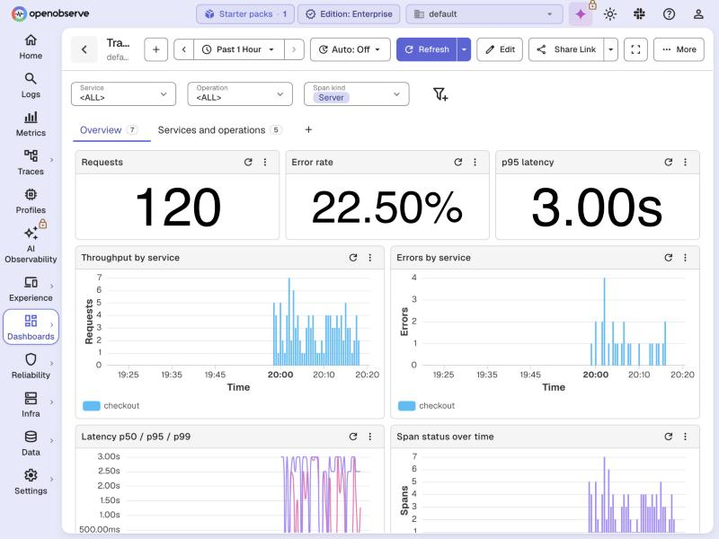

# Traces APM Dashboard

Requests, errors and duration (RED) for every service that sends OpenTelemetry traces to OpenObserve. All panels read the traces stream `default` and count entry spans (span kinds server and consumer by default). Per service, a request is counted once. The all-services totals add up the entry spans of every service, so one user request that passes through three services counts three times.

## Dashboard Features

- **Overview tab**: request count, error rate and p95 latency; throughput and errors per service; p50/p95/p99 latency; spans by status over time.
- **Services and operations tab**: a RED table per service and per operation, the slowest service operations by p95, downstream dependencies (client and producer spans per caller service and `server_address`), and the latest error spans with their trace id.

Errors use `span_status = 'ERROR'`, not HTTP status codes. OpenTelemetry SDKs write the HTTP status under `http_status_code` or `http_response_status_code` depending on their version, so a query on either column fails on streams that lack it.

## Variables

- **Service** and **Operation**: multi-select, all by default.
- **Span kind**: Server and Consumer by default (consumer spans cover queue workers); pick Client for outgoing calls.

## How to Import

In OpenObserve, open **Dashboards**, click **Import**, and upload `Traces APM.dashboard.json`. Send traces to the traces stream `default` (Data sources > Traces). If your stream has another name, change `default` in each panel query.

