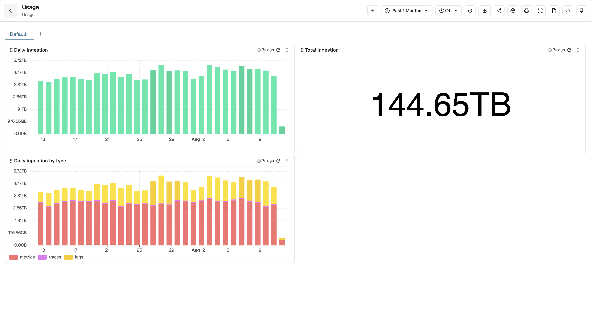

# Usage reporting

This dashboard shows how much data your OpenObserve installation ingests. It reads the `usage` stream in the `_meta` organization.

## Which versions write the usage stream

| OpenObserve version | Open source | Enterprise |
| --- | --- | --- |
| Before v1.1.0 | Off by default. Set `ZO_USAGE_REPORTING_ENABLED=true`. | Always on |
| v1.1.0 to v1.1.2 | Not available. The server does not write the `usage` stream. | Always on |
| v1.2.0 and later | On by default. No configuration is necessary. | Always on |

If you use open source v1.1.0 to v1.1.2, the dashboard stays empty and the server shows no error. Upgrade to v1.2.0 or later to get usage data.

To turn usage reporting off in open source v1.2.0 and later, set `ZO_USAGE_REPORTING_ENABLED=false`.

## What the data contains

In open source, usage records do not contain the organization. The dashboard shows the usage of the full installation.

In Enterprise, usage records contain the organization. You can use this data for chargeback if multiple organizations or teams use your installation.

## Usage

